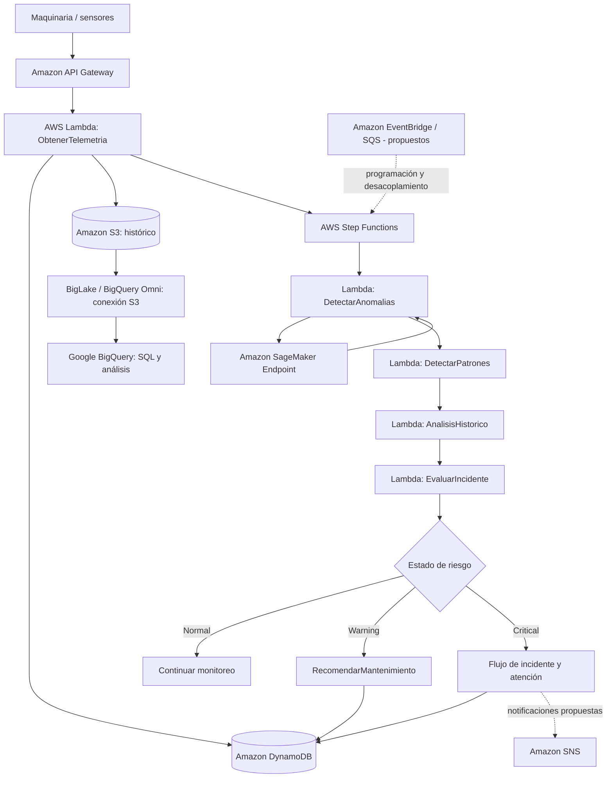

# PaiptaFrita_v.2-Luo-Chao-Chai-
# ArquiFusionCorp — Monitoreo inteligente y mantenimiento predictivo

> **Estado:** prototipo en desarrollo para hackathon. Arquitectura serverless multicloud propuesta; no todos los componentes están desplegados ni integrados.

## Descripción

**ArquiFusionCorp** es una plataforma propuesta para monitorear maquinaria industrial, detectar anomalías, anticipar mantenimientos y apoyar la gestión de incidentes, técnicos y repuestos. El sistema está pensado para múltiples organizaciones (`tenant_id`) de sectores como minería, construcción, infraestructura, agricultura y energía.

Su arquitectura prioriza **AWS** para ingesta, procesamiento y operación, y plantea **Google Cloud BigQuery** para consultas analíticas sobre datos históricos almacenados en **Amazon S3**.

**Repositorio:** https://github.com/ianjrodriguez21/PaiptaFrita_v.2-Luo-Chao-Chai-

## Problemas que buscamos resolver

- Fallas inesperadas y detección tardía de anomalías de temperatura, vibración, presión y combustible.
- Incidentes sin una clasificación clara por gravedad y riesgo.
- Mantenimiento reactivo y poca utilización del historial de cada máquina.
- Asignaciones ineficientes de técnicos según ubicación, especialidad y disponibilidad.
- Falta o exceso de repuestos y escasa trazabilidad de intervenciones.
- Maquinaria infrautilizada o sobrecargada y comunicación deficiente entre roles.

## Objetivos del prototipo

1. Recibir y conservar telemetría por organización y máquina.
2. Detectar comportamientos anómalos con un modelo de ML y reglas operativas.
3. Analizar patrones entre máquinas y tendencias históricas.
4. Calcular riesgo y recomendar mantenimiento preventivo, predictivo o correctivo.
5. Orquestar decisiones mediante AWS Step Functions y gestionar incidentes.
6. Analizar el histórico con consultas SQL en Google BigQuery, sin duplicación obligatoria de los datos de S3.
7. Diseñar la solución para alta disponibilidad en dos regiones de AWS; **pendiente de implementación y pruebas**.

## Arquitectura objetivo



> El diagrama muestra la **arquitectura planeada**, no un despliegue verificado. El flujo de Step Functions, la conexión de BigQuery y las funciones de atención de incidentes deben configurarse.

### Servicios y responsabilidades

| Componente | Responsabilidad | Situación |
| --- | --- | --- |
| AWS Lambda (Python) | Procesamiento de telemetría, análisis y decisiones | Varias funciones con lógica escrita |
| Amazon API Gateway | Entrada HTTP de datos de sensores | Integración prevista |
| Amazon DynamoDB | Estados, anomalías, análisis y resultados operativos | Acceso codificado en varias Lambdas; provisionamiento pendiente de verificar |
| Amazon S3 | Telemetría e históricos | Escritura implementada en `ObtenerTelemetria.py` |
| Amazon SageMaker | Inferencia de anomalías y patrones | Clientes de invocación en código; endpoint/modelo pendiente de configurar y validar |
| AWS Step Functions | Orquestación y decisiones por estado | Previsto; no se encontró definición de máquina de estados en el repositorio revisado |
| Amazon SNS, SQS y EventBridge | Notificaciones, colas y ejecución programada | Planificados |
| Google BigQuery + BigLake/Omni | Consultas SQL de histórico almacenado en S3 | Integración propuesta, aún no configurada |
| Despliegue AWS en dos regiones | Alta disponibilidad y recuperación | Requisito pendiente de diseño detallado y validación |

## Estructura actual del repositorio

```text
.
├── AnalisisOperativo/
│   ├── analizarEficacia.py
│   ├── calcularUtilizacion.py
│   └── predecirRepuestos.py
├── Evaluacion de mantenimiento/
│   ├── AnalisisHistorico.py
│   ├── DetectarAnomalias.py
│   ├── DetectarPatrones.py
│   ├── EvaluarIncidente.py
│   ├── RecomendarMantenimiento.py
│   ├── ArchivosJASONDePrueba/
│   └── DecidirMantenimento/
│       ├── CerrarIncidente.py               # vacío
│       ├── NotificarUsuario.py              # vacío
│       ├── No/
│       │   └── ActualizarEstado.py
│       └── Si/
│           ├── AsignarTecnico.py            # vacío
│           ├── BuscarRepuestos.py           # vacío
│           ├── CrearIncidente.py            # vacío
│           ├── RegistrarIntervenccion.py    # vacío
│           └── TecnicosDisponibles.py       # vacío
├── telemetria/
│   └── ObtenerTelemetria.py
└── README.md
```

> Los nombres se conservaron como aparecen en la rama `main` al momento de revisar el repositorio.

## Funcionalidades: implementadas vs. pendientes

**Código con implementación inicial:**

| Archivo | Función |
| --- | --- |
| `telemetria/ObtenerTelemetria.py` | Valida identificadores mínimos, añade timestamp y guarda telemetría en S3 y DynamoDB. |
| `Evaluacion de mantenimiento/DetectarAnomalias.py` | Envía características al endpoint de SageMaker; registra anomalías en DynamoDB. |
| `Evaluacion de mantenimiento/DetectarPatrones.py` | Busca anomalías recientes de la flota y contempla inferencia con SageMaker. |
| `Evaluacion de mantenimiento/AnalisisHistorico.py` | Revisa tendencias e incidentes previos; guarda resultados en DynamoDB y opcionalmente S3. |
| `Evaluacion de mantenimiento/EvaluarIncidente.py` | Combina anomalía, patrones e histórico para estimar riesgo y estado (`normal`, `warning`, `critical`). |
| `Evaluacion de mantenimiento/RecomendarMantenimiento.py` | Genera recomendaciones por riesgo, recurrencia y horas de operación. |
| `AnalisisOperativo/calcularUtilizacion.py` | Calcula porcentaje de tiempo operativo. |
| `AnalisisOperativo/analizarEficacia.py` | Clasifica máquinas como normales, sobreutilizadas o infrautilizadas. |
| `AnalisisOperativo/predecirRepuestos.py` | **Registra predicciones recibidas como entrada**; todavía no entrena ni ejecuta un modelo predictivo propio. |
| `Evaluacion de mantenimiento/DecidirMantenimento/No/ActualizarEstado.py` | Implementación inicial de actualización de estado. |

**Archivos vacíos o módulos que aún deben completarse:** creación/cierre de incidentes, asignación de técnicos, búsqueda/reserva de repuestos, registro de intervenciones, notificaciones y endpoints del frontend. Las funciones de reserva de repuestos y consultas del frontend figuran en la planificación, pero no como módulos operativos confirmados en la estructura revisada.

## Flujo funcional propuesto

1. Un sensor envía telemetría con `tenant_id` y `machine_id`.
2. `ObtenerTelemetria` guarda la lectura en S3 (histórico) y DynamoDB.
3. Step Functions inicia el análisis: anomalías → patrones entre máquinas → histórico → evaluación del riesgo.
4. Según el resultado, se continúa el monitoreo, se recomienda mantenimiento o se inicia la atención de un incidente.
5. En el flujo crítico futuro se crea el incidente, se localizan técnicos, se comprueban repuestos y se registra la intervención.
6. Google BigQuery ejecuta consultas analíticas sobre los datos históricos de S3.

## Ejemplo de telemetría

```json
{
  "tenant_id": "MINA_A",
  "machine_id": "MAC-102",
  "machine_type": "excavator",
  "latitude": -12.05,
  "longitude": -77.03,
  "operating_hours": 1250,
  "temperature": 105,
  "vibration": 8.2,
  "pressure": 220,
  "fuel_consumption": 32,
  "fuel_level_liters": 204,
  "fuel_level_percentage": 76,
  "load_transported": 15000,
  "speed": 5.5,
  "engine_rpm": 1850,
  "current_status": "operational"
}
```

### Contratos esenciales de datos

- **Maquinaria:** `tenant_id`, `machine_id`, tipo, ubicación, horas de uso y señales de sensores.
- **Técnicos:** `tenant_id`, `technician_id`, ubicación, especialidades y disponibilidad.
- **Repuestos:** `tenant_id`, `part_id`, cantidad, stock mínimo y almacén.
- **Incidentes:** `incident_id`, máquina, tipo, gravedad (`low`, `medium`, `high`, `critical`), riesgo y estado (`open`, `assigned`, `in_progress`, `resolved`).
- **Mantenimiento e historial:** fechas, técnico, partes utilizadas, diagnóstico y resultado.

Se debe conservar `tenant_id` a lo largo de cada flujo y aplicar aislamiento y permisos por organización. No basta con aceptar `tenant_id` enviado por un cliente sin autenticar.

## Integración AWS S3 ↔ Google Cloud BigQuery

**Sí es viable:** Google Cloud permite crear tablas externas **BigLake sobre Amazon S3**, usando **BigQuery Omni** y una conexión con permisos delegados. Esto permite consultar el contenido sin copiar necesariamente todo el dataset a Google Cloud Storage.

### Pasos de integración propuestos

1. **Definir región y formato.** Elegir una región AWS compatible con BigQuery Omni y una región de dataset/conexión correspondiente. Revisar costos y disponibilidad regional.
2. **Preparar datos analíticos en S3.** Usar una ruta separada, por ejemplo `s3://MI_BUCKET/analytics/telemetry/`, con archivos **JSONL** o **Parquet** y esquema consistente. Para crecer, preferir Parquet particionado.
3. **Crear una conexión BigQuery a Amazon S3** desde Google Cloud y configurar el rol IAM de AWS con permisos mínimos de lectura (`s3:ListBucket` y `s3:GetObject`, según recursos y prefijos).
4. **Crear dataset y tabla externa** de BigLake que apunte a la ruta S3.
5. **Ejecutar consultas SQL** agrupando por `tenant_id`, máquina y periodo.
6. **Verificar seguridad y costos:** identidades, ubicación de datos, transferencias, permisos y costo de consultas.

**Importante sobre el código actual:** `ObtenerTelemetria.py` escribe **un objeto JSON por archivo** (`tenant_id/machine_id/timestamp_uuid.json`). Antes de crear la tabla analítica, recomendamos una etapa de normalización a **JSONL (un registro por línea)** o **Parquet** con un esquema estable y una ruta separada. No asumir que los JSON actuales ya son una tabla externa lista para consultar.

Ejemplo orientativo de SQL, **después de crear una conexión y disponer de archivos JSONL**:

```sql
-- Sustituir project-id, conexión, región y bucket por valores reales.
CREATE EXTERNAL TABLE `project-id.operaciones.telemetria_s3`
WITH CONNECTION `project-id.aws-us-east-1.s3-connection`
OPTIONS (
  format = 'JSONL',
  uris = ['s3://MI_BUCKET/analytics/telemetry/*.jsonl']
);
```

```sql
SELECT
  tenant_id,
  machine_id,
  COUNT(*) AS total_lecturas,
  ROUND(AVG(temperature), 2) AS temperatura_media,
  ROUND(MAX(vibration), 2) AS vibracion_maxima
FROM `project-id.operaciones.telemetria_s3`
WHERE tenant_id = 'MINA_A'
GROUP BY tenant_id, machine_id
ORDER BY temperatura_media DESC;
```

> El SQL anterior es ilustrativo: requiere una conexión BigLake válida, permisos IAM y un esquema compatible. `project-id` y `MI_BUCKET` son marcadores, **no valores configurados**.

Documentación oficial:
- [Conectar BigQuery a Amazon S3](https://docs.cloud.google.com/bigquery/docs/omni-aws-create-connection)
- [Crear tablas BigLake en S3](https://docs.cloud.google.com/bigquery/docs/omni-aws-create-external-table)

## Preparación y pruebas locales

**Requisitos para trabajar con las Lambdas:** Python 3, `boto3`, acceso a una cuenta de AWS y permisos de IAM adecuados. Para un despliegue reproducible faltan por definir el archivo de infraestructura (`serverless.yml`, SAM o CDK), dependencias, roles, tablas, índices, buckets, máquina de estados y endpoint de SageMaker.

```bash
git clone https://github.com/ianjrodriguez21/PaiptaFrita_v.2-Luo-Chao-Chai-.git
cd PaiptaFrita_v.2-Luo-Chao-Chai-
python -m venv .venv
source .venv/bin/activate  # En Windows: .venv\Scripts\activate
pip install boto3
```

Las Lambdas utilizan el handler `lambda_handler(event, context)`; por ejemplo, `ObtenerTelemetria.py` espera las variables de entorno:

| Variable | Uso |
| --- | --- |
| `S3_BUCKET_NAME` | Bucket del histórico de telemetría |
| `DYNAMODB_TABLE_NAME` | Tabla de telemetría actual |
| `SAGEMAKER_ENDPOINT` | Endpoint de inferencia requerido por las funciones de detección |
| `ALERTS_TABLE_NAME` | Tabla donde guardar anomalías |
| `ANALYSIS_BUCKET_NAME` | Bucket opcional para resultados de análisis histórico |

Otros módulos tienen variables de entorno propias. **No subir llaves ni secretos al repositorio**; usar roles IAM y gestión de secretos apropiada. La configuración exacta de tablas e índices debe corresponder a las consultas del código.

### Estado del despliegue

No se encontró un manifiesto de Serverless Framework, AWS SAM o CDK en la rama `main` revisada. Por tanto, **no existe todavía un comando de despliegue validado** documentable para este repositorio. Los ejemplos JSON en `ArchivosJASONDePrueba/` sirven como referencia de entradas; su existencia no demuestra que los flujos estén integrados.

## Roadmap

- [x] Organizar funciones iniciales de telemetría, análisis de riesgo y utilización.
- [x] Escribir parte de la lógica Lambda en Python con integraciones AWS.
- [ ] Unificar nombres, contratos JSON y manejo de errores entre funciones.
- [ ] Crear infraestructura como código (API Gateway, Lambdas, DynamoDB, S3, SageMaker y permisos).
- [ ] Crear y probar la máquina de estados de Step Functions con bifurcaciones normal/warning/critical.
- [ ] Completar creación y cierre de incidentes, técnicos, repuestos, intervenciones y notificaciones.
- [ ] Configurar SageMaker y validar inferencia con datos de prueba.
- [ ] Normalizar telemetría de S3 a JSONL/Parquet e integrar BigLake/BigQuery Omni.
- [ ] Implementar autenticación y autorización por tenant/rol.
- [ ] Diseñar y comprobar estrategia multirregión (replicación S3, DynamoDB y failover).
- [ ] Añadir pruebas automáticas, logs, métricas, alarmas y control de costos.
- [ ] Construir endpoints del frontend y preparar demostración/video del hackathon.

## Consideraciones técnicas

- La clasificación del riesgo y el mantenimiento combinan reglas de negocio y resultados de modelos; no toda la lógica es ML.
- Los umbrales de riesgo actuales son de prototipo y deben calibrarse con información real.
- Dos regiones no implican alta disponibilidad automáticamente: se requieren replicación, enrutamiento, monitoreo y procedimientos de recuperación.
- Una tabla de telemetría de estado actual y un histórico analítico tienen patrones de lectura distintos: revisar diseño de claves, índices y retención.
- La arquitectura de referencia no contempla máquinas virtuales.

## Equipo y contribución

Proyecto colaborativo para hackathon. Los integrantes pueden abrir *issues* y *pull requests* para implementar las funcionalidades pendientes. Antes de integrar una Lambda, documentar su entrada, salida, errores, recursos AWS e IAM requeridos.

---

**ArquiFusionCorp** — datos operativos, análisis inteligente y decisiones de mantenimiento sobre una arquitectura serverless multicloud.